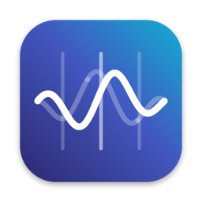
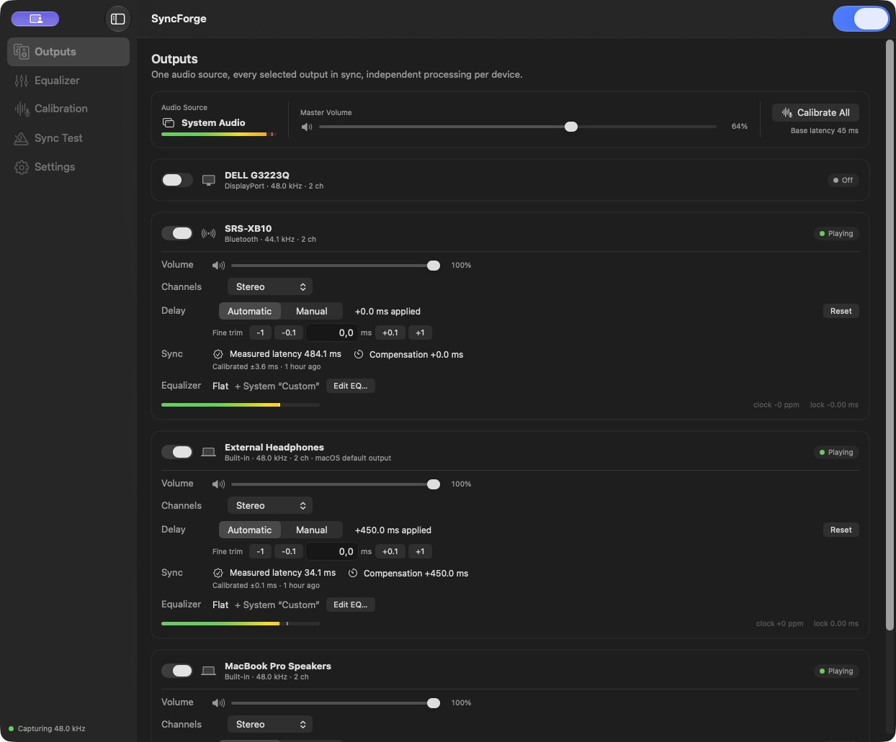
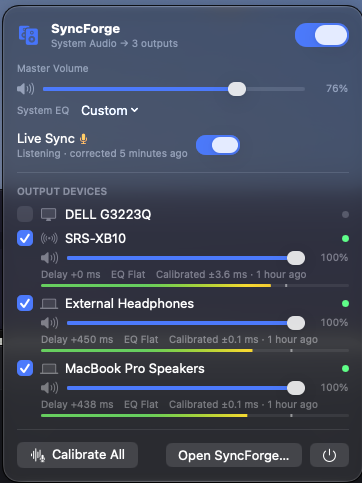
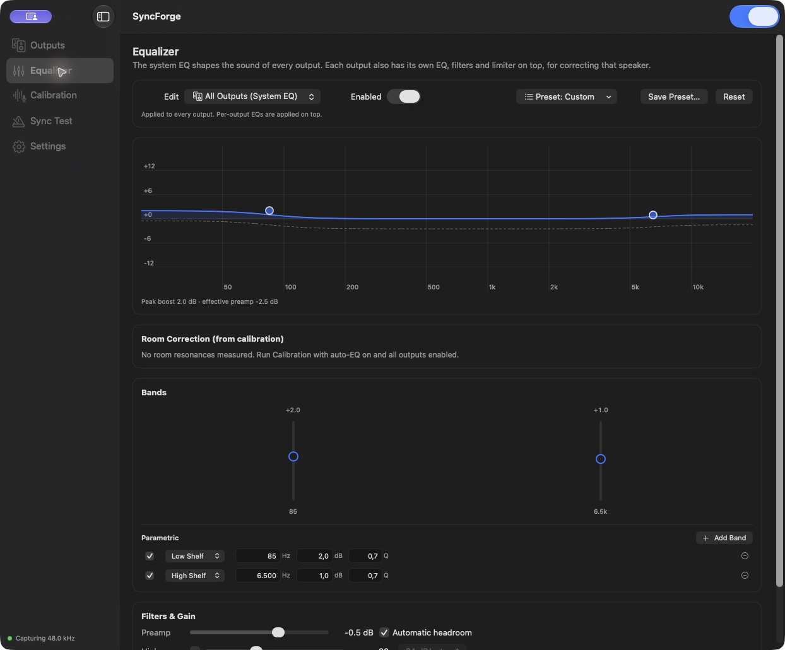
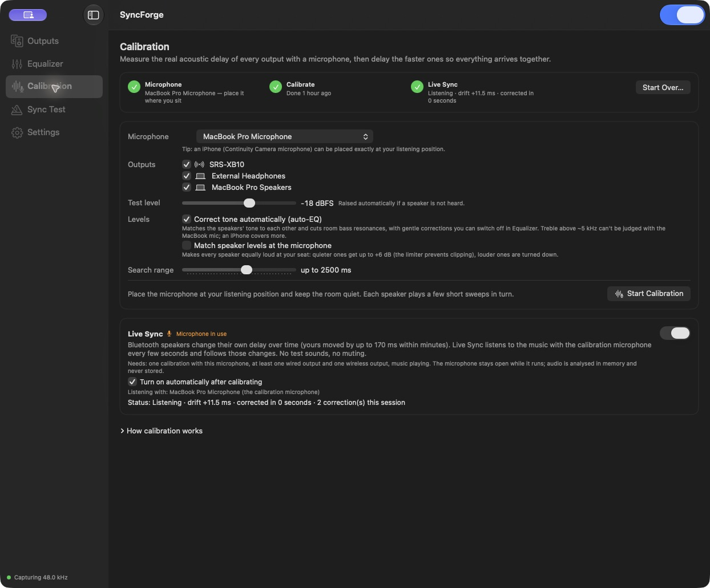

<p align="center">
  
</p>
<h1 align="center">SyncForge</h1>
<p align="center"><strong>Play Bluetooth and wired speakers together.</strong></p>
<p align="center">Align their timing with your Mac or iPhone microphone.</p>
<p align="center">
  <a href="https://github.com/alexandrustefan/syncforge/actions/workflows/ci.yml"></a>
  <a href="LICENSE"></a>
  
  
</p>

SyncForge combines Bluetooth speakers with wired, USB, HDMI or built-in speakers to play your Mac's
system audio together. Different speakers introduce different delays, especially over Bluetooth.
SyncForge uses a microphone at your listening position to hear a short test sound from each speaker,
measure when it arrives, and delay the faster speakers to match the slowest.

**Your Mac's built-in microphone is enough for timing calibration.** You can also use a compatible
iPhone as a microphone through macOS Continuity Camera and place it where you sit. No separate
measurement microphone or audio interface is needed. Each speaker keeps its own volume and EQ.

It runs in the menu bar, captures audio through Core Audio process taps, and needs no virtual audio
driver. Audio processing and microphone analysis stay on your Mac.



**Early public release.** Capture, playback and calibration have been exercised on an Apple Silicon
Mac with built-in, analog and Sony SRS-XB10 outputs. Automated tests cover the DSP, timing kernel,
lifecycle failures and concurrency. Reconnect, sleep/wake and long-session behavior still need
hardware qualification. [Validation record](docs/VALIDATION.md).

## What it does

| | |
|---|---|
| **Multiple outputs** | A renderer for each device, with independent clocks, sample-rate conversion, volume and mute. |
| **Acoustic calibration** | Microphone sweeps measure when each speaker reaches your listening position; automatic compensation delays the faster outputs. |
| **Live Sync** | Optional passive monitoring follows candidate latency changes in one wireless output while music plays. No extra test sounds. |
| **System + speaker EQ** | Parametric bands, shelves, notch, high/low-pass filters, nine tone presets, automatic headroom and per-output limiting. |
| **Automatic tone correction** | Calibration can match relative speaker tone and reduce room bass resonances. It is not a substitute for a calibrated measurement microphone. |
| **Fine control** | Manual delays and 0.1 ms trim, channel modes, saved device profiles and setups. |
| **Local processing** | No account, telemetry, network service or audio upload. Microphone samples are processed in memory. |

## Screenshots

<table>
  <tr>
    <td width="34%" valign="top">
      <strong>At home in the menu bar</strong><br><br>
      <a href="docs/images/menu-bar.png"></a>
    </td>
    <td width="66%" valign="top">
      <strong>One EQ for the room, another for each speaker</strong><br><br>
      <a href="docs/images/equalizer.jpg"></a>
    </td>
  </tr>
</table>

<details>
<summary><strong>Calibration and Live Sync</strong></summary>



</details>

Screenshots show a real setup from an earlier interface revision. Device names, delays and correction estimates are examples, not
recommended settings or independent proof of acoustic alignment.

## Build and run

You need **macOS 14.4+**, the full **Xcode 16.4+** installation, and
[XcodeGen](https://github.com/yonaskolb/XcodeGen). CI builds with Xcode 16.4; local development has
also used Xcode 26.4. Apple Silicon has been exercised on hardware; Intel hardware is unqualified.

```sh
git clone https://github.com/alexandrustefan/syncforge.git
cd syncforge
brew install xcodegen
scripts/build.sh --test
```

The build produces `build/SyncForge.app`. Move it to `~/Applications`, then open it. There is no
notarized download yet. For a repeatable local signing identity, install options and troubleshooting,
see [building from source](docs/BUILDING.md).

On first use, allow **System Audio Recording**. Calibration and Live Sync also need **Microphone**
access. These permissions are managed in macOS System Settings.

1. Pick your outputs and turn SyncForge on.
2. Open **Calibration**, choose a microphone at your listening position, and start calibration.
   It plays short sweeps and temporarily mutes the program audio.
3. Enable **Live Sync** if you want passive monitoring of one wireless output.
4. Use **Equalizer** for the system curve or an individual speaker. **Sync Test** provides clicks
   for manual fine adjustment.

Start at a comfortable playback level. To return to normal macOS playback, switch SyncForge off or
quit it. [Full usage guide and troubleshooting](docs/USAGE.md).

## How synchronization works

```text
System audio → Core Audio process tap → shared audio timeline
                                          ├─ delay + resample + EQ → wired output
                                          ├─ delay + resample + EQ → Bluetooth output
                                          └─ delay + resample + EQ → other output

Microphone → calibration / Live Sync analysis → compensation updates
```

Each output reads the same timeline on its own hardware clock. Calibration estimates relative
acoustic arrival times; the fastest path waits for the slowest. A shared base buffer and a
windowed-sinc resampler handle scheduling and clock-rate differences. The audio callbacks run in C11;
Swift coordinates devices, analysis and the UI. There are no third-party runtime dependencies.

Live Sync analyzes fresh three-second recordings about every 3.7 seconds, on a separate actor.
Two usable agreeing windows can trigger a correction. Identical music at a single microphone cannot
always distinguish speaker drift from a room reflection; some signals remain unobservable.
[Architecture](docs/ARCHITECTURE.md) · [Live Sync research and benchmarks](docs/LIVE_SYNC_RESEARCH.md).

## Limits and validation

- **Bluetooth timing moves.** Sub-2 ms acoustic synchronization is not claimed. Driver latency and
  the renderer's clock-lock error are not measurements of speaker arrival at your ears.
- **Live Sync follows one wireless output**, needs at least one wired reference and informative
  program audio, and keeps the microphone open while enabled. Faster checks do not guarantee a
  correction deadline or correct path identification.
- **Extra playback latency affects video.** Faster outputs must wait for slower ones; this is not
  a low-latency monitoring tool or discrete surround system.
- **Device support varies.** USB, HDMI and multichannel routes, reconnect and sleep/wake recovery,
  and a 30-minute hardware soak still need qualification. DRM-excluded audio cannot be captured.
- **CPU depends on the whole setup.** The complete offline Live Sync analysis measured about
  20 ms CPU per check on an M3 Max, projecting roughly 0.54% of one core at its nominal cadence.
  That excludes capture, rendering and UI. It is not a whole-app CPU guarantee.

Run the automated suite without opening audio devices:

```sh
cd SyncForgeKit
swift test -c release
```

The suite currently contains 72 ordinary tests and one opt-in offline benchmark. Hardware claims,
test conditions and known gaps are recorded in [VALIDATION.md](docs/VALIDATION.md).

## Documentation and contributions

- [Building, local signing and CLI](docs/BUILDING.md)
- [Usage and troubleshooting](docs/USAGE.md)
- [Architecture](docs/ARCHITECTURE.md) and [development notes](docs/DEVELOPMENT_NOTES.md)
- [EQ presets and sources](docs/EQ_PRESETS.md)
- [Live Sync research](docs/LIVE_SYNC_RESEARCH.md) and [design references](docs/RESEARCH.md)
- [Contributing](CONTRIBUTING.md) · [Security reporting](SECURITY.md)

Bug reports with a reproducible setup are welcome. Distinguish offline test results, device behavior
and independently measured acoustic results. Please redact device UIDs and personal information
before sharing logs or configuration files.

## License

[MIT](LICENSE) © 2026 Alexandru Stefan.
